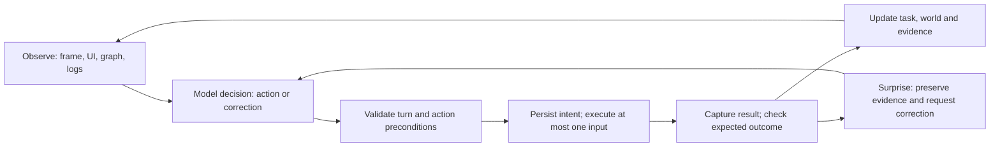

# Building AI agents that improve games through evidence

**An engineering case study in connecting AI decisions to real game behaviour, checking outcomes, and learning from failures.**

This project builds an AI agent that operates *Wylde Flowers*, a commercial 3D macOS game, through screenshots,
mouse clicks and keyboard input. It combines local visual recognition, persistent task and world state, model-owned
decisions, and verification against the game's logs and decoded saves.

The broader problem is relevant to autonomous game optimisation: **how do you let an agent change something,
measure what actually happened, and decide whether that change deserves to persist?**

This repository implements parts of that loop in a gameplay automation test bed. It is not a shipped mobile SDK or
a retention optimisation product. Its value as a case study is the concrete engineering underneath the agent:
execution boundaries, durable state, evidence provenance, recovery and evaluation.

## The engineering problem

A plausible model answer is only the beginning. A practical agent must also handle:

- ambiguous visual evidence and objects that look alike;
- delayed animations, changing screens and stale coordinates;
- interrupted tasks that must resume without repeating a purchase or losing an interaction phase;
- actions whose delivery is uncertain after a timeout;
- apparent success contradicted by application evidence;
- corrections that help one case but may regress another.

These issues surfaced during navigation, gardening and shop interactions. They led to a design that records intent
before execution, preserves evidence around each action, and separates proposed outcomes from verified outcomes.

## What is implemented

The current public gameplay entry point is a **model-owned turn loop**. Local code gathers clues and may recommend
an action; the gameplay model explicitly chooses each continuation. An observation returns `NEXT` without issuing
input. A versioned decision can execute at most one guarded input.



| Capability | Implementation and purpose |
|---|---|
| Model-owned decisions | [play.py](tools/game/play.py) and [turn.py](tools/game/turn.py) expose observations, accept explicit decisions and guard execution. The model is not merely an exceptional vision fallback. |
| Durable task state | [task_state.py](tools/game/task_state.py) persists the active target, interaction phase, crop, nested subgoals and pending intent, using the SQLite runtime store. |
| Grounded perception | OCR, Apple Vision feature prints and DINOv2 patch embeddings provide text, visual matches and object candidates. Labelled examples live in local vector stores. |
| World and navigation memory | Object state, containment and relations live in a graph. [navigation.py](tools/game/navigation.py) supplies walkable graph paths, qualitative localization, compass/range hints and progress checks for model-selected waypoints. |
| Action verification | [primitives.py](tools/game/primitives.py), [experience.py](tools/game/experience.py) and [integrate.py](tools/game/integrate.py) connect actions to observations, verification checks and replayable updates. |
| Transport uncertainty | [wfc.py](tools/wfc.py) avoids automatically resending a request when it may already have reached the daemon. A timeout is not treated as proof that nothing happened. |
| Human-readable audit trail | Each run has timestamped decisions, results and corrections in `decisions.md`, generated from the canonical SQLite timeline. Navigation entries include graph and compass evidence. |
| Evaluation tooling | Component hit/miss records, captured replay tests and benchmark tooling track calls, elapsed time, stuck episodes and escalations. |

Visual similarity identifies an appearance or kind; it does not prove the identity of one of several identical beds.
Positioned game events and other scoped evidence bind interactions to actual objects. Save-derived facts carry
provenance because an autosave can lag behind the live screen.

Transition tables remain available as knowledge and recommendation inputs. Older scheduler code and historical
specifications also remain in the repository; they should not be mistaken for the current public execution contract.

## Learning without trusting every model answer

The system distinguishes several kinds of correction:

1. **State:** apply a verified event to the current world or interaction.
2. **Perception:** add a labelled appearance example or correct a mistaken match with supporting evidence.
3. **Behaviour knowledge:** record transition observations and revise expectations when outcomes disagree.
4. **Implementation:** preserve a gap for an offline code change, replay and live verification.

The integration boundary journals applied updates so replay need not teach the same experience twice. Runtime code
does not rewrite itself during an action. Model explanations are useful hypotheses; application evidence determines
what can be recorded as verified.

For example, a purchase requires matching inventory and money evidence. A refused click must remain distinguishable
from a click that reached the game but failed. An interrupted gardening task must retain its target and phase while
resolving a surprise. These are constraints on agent execution, not prompt-only requests to “be careful.”

## Applying the approach to autonomous mobile game optimisation

Consider a product consisting of a lightweight Unity SDK and a cloud agent that detects player friction, proposes
changes to retry assistance, rewards, difficulty pacing or ad timing, and retains changes only when they improve
retention.

The transferable engineering pattern is:

**observe → form a hypothesis → constrain an intervention → execute → measure → promote or roll back**

There is an additional requirement: a gameplay receipt can establish that an action happened, whereas retention
uplift requires a causal experiment across players. The benchmark tooling here is not an A/B testing engine and
does not establish Day 1, Day 7 or Day 30 retention improvement.

| This repository demonstrates | How the capability transfers | Additional product work |
|---|---|---|
| Structured observations and evidence provenance | Trace a player-friction hypothesis to specific telemetry | Unity event schema, analytics adapters, identity and data-quality checks |
| Explicit decisions with constrained execution | Let the agent choose among approved interventions | Typed remote configuration, eligibility rules and studio-owned limits |
| Persistent tasks and pending intents | Recover experiment orchestration without duplicate launches | Durable cloud workflows, versioned assignments and deployment state |
| Before/after evidence and outcome checks | Verify actual treatment exposure before interpreting metrics | Stable randomisation, control groups, exposure events and cohort analysis |
| Guard refusals and preserved failures | Stop or reverse harmful treatment and retain its history | Operational and product guardrails, kill switch and automatic rollback |
| Replay, evaluation and recorded corrections | Investigate bad hypotheses and improve future proposals | Experiment analysis, staged promotion and cross-game validation |

### A concrete MVP application

An initial pilot could test **optional retry assistance after repeated level failure**:

1. The SDK reports level attempts, failures, retry offers, actual offer exposure and subsequent sessions.
2. The cloud agent identifies an eligible segment and proposes a bounded assistance change, including its hypothesis.
3. The experiment service assigns eligible players consistently to treatment or control before exposure. An
   appropriate persistent holdout measures the cumulative effect of the optimisation programme.
4. The SDK applies a versioned configuration at a defined safe boundary and acknowledges the version used.
5. Guardrails monitor operational failures and agreed player-experience or commercial limits. A breach disables
   the treatment and restores the known configuration, subject to client connectivity and cache expiry.
6. The analysis service evaluates mature retention cohorts under a predefined statistical decision rule. The agent
   receives the result and evidence, then proposes promotion, revision or rejection within its authority.

Retry completion and session length can provide early diagnostic signals, but they cannot substitute for retention.
D1, D7 and D30 need explicit definitions, adequate sample sizes and time for cohorts to mature. If all three are
required for final promotion, D30 results cannot be available in a weekly demo. Weekly demos can show integration,
experiment delivery, guardrail behaviour and outcomes whose observation windows have actually completed.

Repeatedly checking ordinary significance tests, changing eligibility after exposure, or comparing self-selected
player groups would undermine the result. Experiment assignment, analysis rules and treatment history belong in
the experimentation service; the LLM proposes hypotheses and interprets evidence within that contract.

### Remote changes have a defined boundary

“No app update” is achievable for **behaviours already exposed by the installed SDK integration**: reward amounts,
retry policies, difficulty parameters or allowed ad-placement settings. A new game mechanic or a missing client hook
still requires an app update. The SDK should ship validated configuration schemas, local defaults, cached versions
and an expiry policy so play remains functional when the cloud is unavailable.

The under-30-minute integration target should be measured with a sample Unity project and a studio onboarding pilot:
install, initialise, emit required events, wire the first intervention hook and confirm exposure in the dashboard.
Actual integration time depends on the game's existing analytics and gameplay hooks.

A framework such as GrowthBook could be evaluated for assignment and experiment analysis. The surrounding cloud
orchestrator would still need to connect hypotheses, approved interventions, exposure evidence, guardrails and
rollback. No Unity/C#, cloud backend, GrowthBook integration or live studio pilot is implemented in this repository.

## Current status and limits

- **Implemented:** the Python/macOS gameplay toolkit, model-owned turn protocol, durable interactions, visual
  memories, graph/navigation evidence, verification and logging infrastructure.
- **Validation:** historical live demonstrations and offline tests exist. Some current universal workflows still
  list live verification as pending. This README makes no claim of unattended production reliability or a measured
  end-to-end success rate.
- **Research directions:** local Qwen inference, RxInfer belief models and Laya-like specialists have been discussed.
  They are not integrated into the current runtime. Their value needs comparative measurement before adoption.
- **Product extension:** the mobile retention system above is an application design showing how the engineering
  approach transfers. It is not an existing customer deployment or a claim of measured retention uplift.

The current stack is Python, macOS Quartz/Apple Vision through PyObjC, NumPy, PyTorch/DINOv2 and SQLite runtime
state. An external model-capable agent drives gameplay turns; installing the repository does not provision a local
model or start an autonomous cloud agent.

## Inspect or run the project

The test bed requires macOS, *Wylde Flowers*, Python 3.12+, `uv`, Screen & System Audio Recording permission and
Accessibility permission. The wrapper uses the repository's virtual environment.

```sh
uv sync
./wf status
./wf world kinds
```

For a model-driven run, create a task directory and review its plan before continuing:

```sh
./wf run start garden-demo "Inspect and maintain the garden"
./wf play garden region=Garden
```

The second command observes and returns `NEXT`; it does not automatically complete gardening. The model reads the
current frame and evidence, then supplies a decision with the exact returned `turn_id`. Read the
[gameplay workflow](.claude/skills/wylde-play/SKILL.md) and
[action contract](.claude/skills/wylde-play/actions/INDEX.md) before issuing a continuation.

Check the current source-specific game clock before gameplay and follow the active deadline and human-handoff
rules in [AGENTS.md](AGENTS.md), [requirements.md](requirements.md) and the gameplay workflow. Spending, sleeping
and story choices follow the user's task scope.

Structured runtime state is local and git-ignored in `runs/wf.sqlite3`; task directories hold human-readable
projections and media:

```text
runs/wf.sqlite3   authoritative runs, tasks, observations, intents, experiences and world overlays
runs/<timestamp>-<task>/
  plan.md          task plan
  decisions.md    generated timestamped observation, decision, outcome and correction summaries
  progress.md     generated step timestamps and budget tracking
  retro-N.md      run-local retrospective
```

Runtime recovery reads SQLite, not Markdown or legacy run-local JSON files. JSONL is available as an explicit
`./wf run export --jsonl <run>` diagnostic export. See the [runtime store](docs/architecture/runtime-store.md).

Read summaries with `./wf run status`, inspect component evaluation with `./wf eval`, and compare recorded benchmark
runs with `./wf bench compare`. These commands expose evidence; they do not by themselves establish reliability.

## Repository guide

| Area | Start here |
|---|---|
| Runtime storage | [runtime-store.md](docs/architecture/runtime-store.md), [schema.py](tools/runtime/schema.py), [world_store.py](tools/game/world_store.py) |
| Public gameplay loop | [play.py](tools/game/play.py), [turn.py](tools/game/turn.py), [task_state.py](tools/game/task_state.py) |
| Guarded actions and verification | [primitives.py](tools/game/primitives.py), [experience.py](tools/game/experience.py), [integrate.py](tools/game/integrate.py) |
| Perception and world memory | [observe.py](tools/game/observe.py), [objects/](tools/objects), [world.py](tools/game/world.py) |
| Navigation evidence | [navigation.py](tools/game/navigation.py) |
| Runtime and transport | [wf.py](tools/wf.py), [wfc.py](tools/wfc.py), [runtime/](tools/runtime) |
| Native gameplay bridge and timing | [native_bridge.py](tools/game/native_bridge.py), [native_tools.py](tools/native_tools.py), [owner_timing.py](tools/owner_timing.py) |
| Evaluation | [evals/](tools/evals), [bench/](tools/bench), [turn tests](tools/test_turn.py), [play tests](tools/test_play.py) |
| Operations and game knowledge | [Docs index](docs/INDEX.md), [Wiki index](wiki/INDEX.md), [operating instructions](AGENTS.md) |

## Credits and licences

- *Wylde Flowers* © Studio Drydock. This is an unofficial research project, not affiliated with or endorsed by
  Studio Drydock.
- Imported material in `wiki/` derives from the game's fan wiki (Fandom); CC BY-SA 3.0 attribution is retained.
