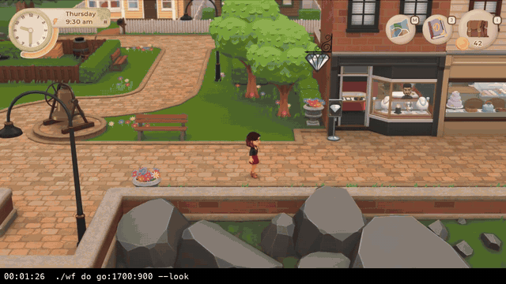
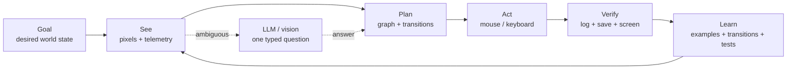

# A self-improving AI agent for software with no automation API

This project builds an AI agent that completes goals in *Wylde Flowers*, a commercial 3D macOS game, through the
same screen, mouse and keyboard interface a person uses. The game has no public automation API, plugin system or
accessibility tree.

The system combines local computer vision, pretrained image embeddings, a world graph, table-driven planning and
LLM/VLM reasoning. The application’s own log and save data provide read-only ground truth: every important action is
checked against what the game says actually happened, and mistakes can become new visual examples, learned
transitions or regression tests.

The game is the test bed. The same architecture applies to GUI software that must be operated from the outside.

<p align="center">
  <br>
  <sub>A quest agent at work (2× speed). The caption is the live tool call.
  <b><a href="docs/media/quest-1.mp4">Full video (MP4, 72 s)</a></b></sub>
</p>

---

## The idea in one loop



### Goal

A task is expressed as a desired state, not a hard-coded procedure. For example:

```json
{
  "kind": "GardenBed",
  "where": {"ready": true, "crop": "!$flowers"},
  "make": {"ready": false}
}
```

The goal says: find ready garden beds, exclude flowers kept for bees, and make them no longer ready. Library goals
live in tools/game/goals.json; an agent can also submit a raw query.

### See

Routine perception stays local:

- vectorized NumPy detectors find prompts, HUD elements and screen modes;
- Apple Vision OCR reads menus, dialogue, clocks and counters;
- Apple Vision feature prints recognize prompt, item and crop icons;
- DINOv2 patch embeddings locate objects by appearance;
- an object-scoped tracker tells whether the avatar is moving;
- the decoded save and live engine log supply objects, state and events.

Most observations therefore become short text such as:

```text
gameplay | Friday 8:00 am | 975c | energy 98% | bubble@1212,616:pickup
```

The model sees an image only when these cheaper signals cannot answer the current question.

### Plan

The save contains hundreds of positioned records with opaque prefab identifiers. tools/game/world.py turns the
records it can identify into a graph:

- nodes are objects and areas;
- kind and state are properties used as filters;
- nearby objects form areas by distance;
- newer log events update stale save state;
- the first event on an unnamed prefab can teach its kind.

tools/game/plan.py searches the transition table in tools/game/actions.json. Each row describes:

```text
when → bubble → checked steps → effect
                    └──────────── proof
```

Planning is breadth-first search over effects. Preconditions become subgoals: if watering reports an empty can, the
same engine finds an action that makes Tara.can=full, reaches the well, verifies the fill event, then returns to the
original goal.

### Act

Every input goes through the warm ./wf daemon as a Quartz mouse or keyboard event. A click in the 3D world invokes
the game’s own navmesh pathfinding, so the agent selects a visible object or safe ground rather than dead-reckoning
with movement keys.

Actions are deliberately small and observable. A click record includes:

- the frame and bubbles before the click;
- a burst of frames immediately afterward;
- movement of the avatar;
- new game-log lines;
- cards, text and bubbles after the click.

### Verify

The application supplies stronger evidence than visual guessing:

- the engine log records interactions, pickups, dialogue, scene changes, quest progress and world positions;
- the zstd-compressed JSON save supplies inventory, money, stamina, quests and object state;
- persistent cards and transient bubble changes provide additional evidence.

An action changes the world model only when its required proof appears. For example, the game writes a plant event
even when the seed picker is cancelled, so planting requires the totalPlanted statistic as proof.

### Learn

Learning is incremental and auditable:

- a wrong or unknown prompt can be stored under the action named by the next game event;
- an object crop can be relabelled when the click’s event proves its actual kind;
- an unknown crop icon is named once by vision and added to the icon memory;
- observed action sequences fill gaps in the transition table;
- learned transitions require repeated agreement before they are trusted;
- repeated contradictions revise expectations instead of silently continuing.

This is not end-to-end neural-policy training. The neural encoders are pretrained; the system learns small visual
memories, object identities, graph relations and symbolic transitions from play.

---

## Where AI is used

| Technique | Role in the system |
|---|---|
| **Apple Vision feature prints** | 768-dimensional embeddings for prompt, item and crop-icon recognition |
| **DINOv2-small** | 384-dimensional patch embeddings and heatmaps for locating object kinds in a frame |
| **Nearest-neighbour vector memory** | New visual classes become usable from labelled examples without retraining a model |
| **OCR and object tracking** | Read UI state and determine when movement or an action has finished |
| **World graph** | Maintain objects, areas, state and learned relationships from save, log and click evidence |
| **Symbolic transition planning** | Find actions and subgoals that transform the current state into the requested state |
| **LLM/VLM reasoning** | Select or write goals and resolve one ambiguous click, button or name at a time |
| **Self-supervision from telemetry** | Use application events as labels and proofs instead of trusting the agent’s prediction |

Classic computer vision and ordinary systems engineering remain important. Colour segmentation finds any prompt
before an embedding names it; a warm daemon removes model-loading latency; strict screen rules prevent a world click
from landing on a pause menu. The AI components sit inside those safety boundaries.

---

## One action end to end

Consider the harvest goal: collect every ready non-flower crop.

1. The world graph identifies beds whose save state says ready.
2. The planner selects the pick transition.
3. Perception finds ready bubbles in the target area.
4. Crop-icon vector memory rejects flowers that should remain for the bees.
5. The controller clicks a qualifying bubble.
6. The expected Collect card must appear.
7. Space confirms the card.
8. A grab_item log event proves the harvest and updates the bed.

If the crop icon is unknown, the engine stops before clicking and asks one typed question: “Which crop does this icon
show?” The answer is attached to the pending goal, stored as a visual example and reused on the next matching crop.

The same achieve(goal) loop runs watering, planting, replanting and harvesting. The core engine does not encode a
separate procedure for each chore; compatibility wrappers in tools/game/garden.py translate convenient commands into
goals.

---

## Model orchestration

Models are used at two levels:

1. A supervisor and task agent choose a goal, load the relevant evidence and enforce budgets and user decisions.
2. The engine asks model vision only when local perception or learned data is insufficient.

A vision request has exactly one type:

- **click** — one grid cell containing the next object or safe ground;
- **button** — the exact visible control to use;
- **name** — the identity or key=value state that could not be read.

The question keeps a pending record containing its goal, parameters, transition and failed step. Pending state is
stored per goal, so an answer cannot accidentally update another task. Four unanswered or unproductive questions
stop the run instead of producing blind clicks.

tools/runwatch.py provides an independent live safety view. It reports one line per click and raises STOP or ALERT
for events such as clicking a pause menu, a prediction miss, a failed item selection or an engine call that ends
without completing its goal.

---

## What has been demonstrated

Live runs have exercised the complete loop rather than only isolated detectors:

- a previously unknown second garden appeared from save records as a new area containing 12 beds;
- the generic engine planted all 12 beds with proof from totalPlanted events;
- watering can depletion became a fill-can subgoal;
- ready crop bubbles were separated from visually similar hive bubbles by ownership and state;
- an unknown crop icon produced a typed naming question and a reusable vector example;
- failures involving dusk icons, stale daemon code, unsafe Escape behaviour and unexpected cards became tests and
  explicit rules.

Representative local measurements from the project:

| Operation | Result |
|---|---:|
| Prompt detection with NumPy | about 25 ms |
| HUD/mode checks | under 5 ms |
| Prompt embedding lookup | about 9 ms |
| Warm state observation | about 0.15–0.2 s |
| Act, settle and observe | about 2.3 s |

These numbers are not the main result. The important property is that common observations and outcome checks do not
consume image-model tokens.

---

## Boundaries and known limits

- The system uses no public automation API, but it does use reverse-engineered read-only log and save side channels.
- Icon classification becomes unreliable at dusk and night; icon-dependent goals stop and suggest sleeping.
- The map pin is too coarse for object-level navigation inside dense areas.
- Long walks may still require one vision-provided direction or click cell.
- Some object kinds remain unnamed until a log event or model answer supplies evidence.
- A learned transition is not trusted after one lucky observation.
- User decisions such as spending, selling, sleeping or irreversible story choices remain gated.

---

## Repository map

| Path | Purpose |
|---|---|
| [tools/wf.py](tools/wf.py) · [tools/wfc.py](tools/wfc.py) | Warm control plane: capture, OCR, input, telemetry and the ./wf CLI |
| [tools/game/engine.py](tools/game/engine.py) | Generic achieve(goal) loop |
| [tools/game/world.py](tools/game/world.py) | World graph from save records, log events and click outcomes |
| [tools/game/plan.py](tools/game/plan.py) · [tools/game/actions.json](tools/game/actions.json) | Transition table and effect-path planning |
| [tools/game/observe.py](tools/game/observe.py) · [tools/game/act.py](tools/game/act.py) | Frame observation and fully recorded clicks |
| [tools/game/learn.py](tools/game/learn.py) · [tools/game/ask.py](tools/game/ask.py) | Incremental learning and typed vision questions |
| [tools/objects/](tools/objects) | DINOv2 object detection and NumPy-backed vector stores |
| [tools/runwatch.py](tools/runwatch.py) | Live STOP/ALERT watcher and attempt reports |
| [docs/](docs/INDEX.md) | Progressive task, mechanic, UI and world knowledge |
| [docs/self-improvement.md](docs/self-improvement.md) | Capture → label → store disagreement → verify → reuse |
| [tools/evals/](tools/evals) · [tools/bench/](tools/bench) | Prediction outcomes and repeatable benchmark tasks |
| [tools/record.py](tools/record.py) · [tools/idle.py](tools/idle.py) | Captioned video, activity/event tracks and idle-time analysis |
| [AGENTS.md](AGENTS.md) · [.claude/](.claude) | Agent rules, manifests, roles and gameplay skills |

---

## Running it

Requirements:

- macOS;
- the Apple Arcade macOS build of *Wylde Flowers*;
- Screen & System Audio Recording permission;
- Accessibility permission.

Dependencies are locked with [uv](https://docs.astral.sh/uv/):

```bash
uv sync
```

Basic checks and examples:

```bash
./wf status
./wf state
./wf world kinds
./wf achieve water
./wf achieve plant seed=Tulip region=GardenSouth
./wf achieve harvest
./wf eval
./wf learn
./wf record start
```

All game coordinates use a virtual 1920×1080 frame and are mapped to the actual game window. The current setup runs
the game windowed at 1600×900.

---

## Credits and licences

- Test bed: *Wylde Flowers* © Studio Drydock. This is an unofficial research project and is not affiliated with or
  endorsed by Studio Drydock.
- reference/wiki/ and generated tables under docs/ derive from the game’s fan wiki (Fandom), CC BY-SA 3.0.
