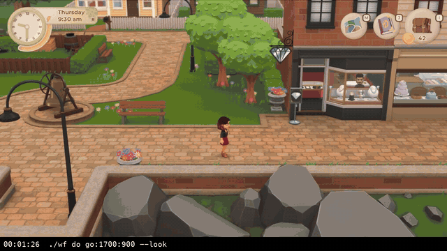
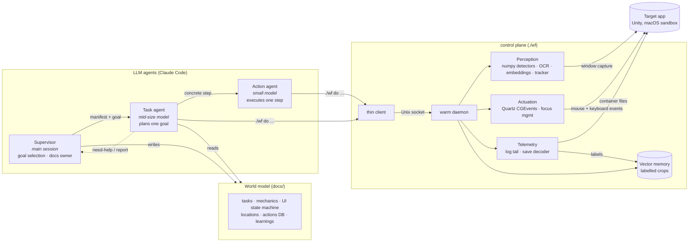
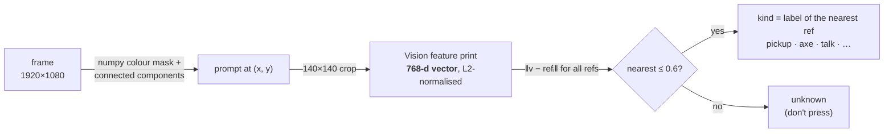
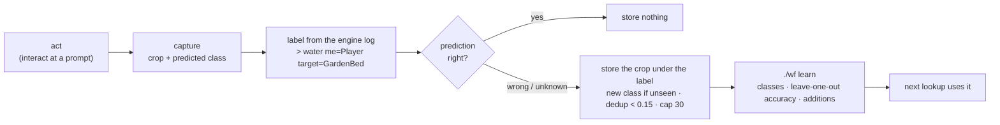
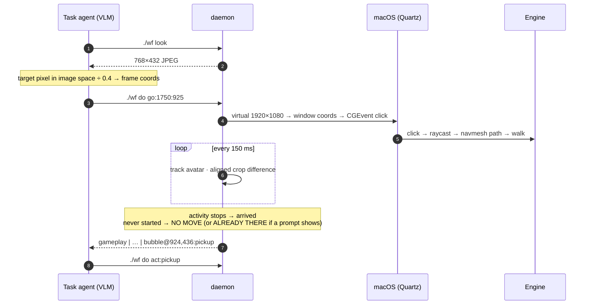
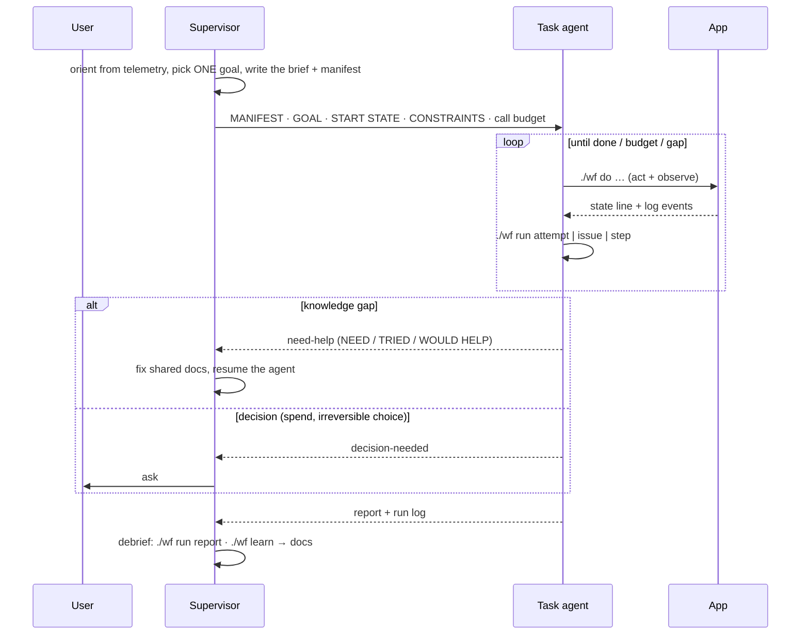

# LLM agents for software with no API

**A hierarchical multi-agent system (Claude Code) that operates a commercial 3D game on macOS end to end, through
pixels, input events and the app's own telemetry.** The perception layer is written as **array programs over raw
frames (numpy)** and **nearest-neighbour search over vision embeddings**, so most observations cost milliseconds and
zero image tokens. The system labels its own training examples from the app's logs and gets better while it runs.

The target app has no API, plugin system or accessibility tree. Everything goes through the same screen and input
devices a human uses, plus side channels found by reverse-engineering the sandboxed app container. The game is just
the test bed: the techniques apply to any GUI that has to be automated from the outside.

<p align="center">
  <br>
  <sub>A quest agent at work (2× speed): one click per navigation hop (engine pathfinding), an interaction, a dialogue,
  and the goal counter updating. The caption is the live tool call. <b><a href="docs/media/quest-1.mp4">Full video (MP4, 72 s)</a></b></sub>
</p>

---

## Highlights

| Area | Technique | Effect (measured) |
|---|---|---|
| **Pixels as arrays** | Frames are `H×W×3` ndarrays; detectors are **vectorized numpy expressions**: colour thresholding, connected components, polar sampling, template distance, shift-aligned differencing, FFT phase correlation | Prompt detection **~25 ms**, meters/mode checks **< 5 ms**, no model calls |
| **Vectors as memory** | 768-d **image embeddings** (Apple Vision feature prints) + **nearest-neighbour** lookup over a folder of labelled crops; distance threshold for "unknown" | **~9 ms** per prompt; leave-one-out **41/41**; one example per new class is enough |
| **Self-labelling** | The app's event log is the ground truth: each interaction it logs labels the crop the agent acted on; unseen labels create new classes; only disagreements are stored | Classes grow from normal use, with no hand labelling |
| **Object-scoped motion** | Vision object tracker on the avatar + **min-over-shifts crop difference** | Arrival detection immune to background motion (water, crowds, camera pans) |
| **Telemetry side channel** | Live tail of the engine log + decoding of the compressed JSON autosave; hashed ids resolved by **CRC32 reverse lookup** over strings mined from the app bundle | Outcome checks are text-only; 413/428 hashed ids decoded |
| **Action** | Clicks on the 3D world trigger the **engine's own navmesh pathfinding**; arrival from the tracker | Approaching a target: **3–6 calls → 1** |
| **Latency** | Warm daemon on a Unix socket, in-memory capture, half-res OCR, run-loop-pumped focus detection | `state` ≈ **0.15–0.2 s**; act+observe ≈ **2.3 s** (was 6–8 s) |
| **Orchestration** | **Supervisor → task agent → action agent**, manifest protocol, `need-help` escalation, hard budgets | Knowledge gaps fixed once in shared docs, reused by every later agent |
| **Observability** | Structured **run logs** + per-frame activity tracks + **idle-time attribution** | Retros start from numbers (e.g. 53% of wall time = model turns between calls) |

---

## System architecture



---

## 1. Perception as array programming

LLM tokens and wall-clock time are the scarce resources, so observation climbs a **cost ladder** and stops at the first
rung that answers the question: telemetry (≈0 ms, text) → numpy/OCR state line (~150 ms, text) → small image for the
model (one 768×432 JPEG) → full screenshot (rare).

The middle rung is the interesting one. A captured frame is a `1080×1920×3` uint8 array; each detector is a few
vectorized numpy operations over it, evaluated in compiled code in milliseconds:

| Question | Array technique | Cost |
|---|---|---|
| Is there an interaction prompt, and where? | **Colour thresholding** to a boolean mask on a 1/4-scale frame, then **connected-component labelling** with size, aspect and fill-ratio filters | ~25 ms |
| Which UI mode (gameplay / dialogue / menu / cutscene)? | Letterbox **luminance means** of the top/bottom bands; **fixed-position template distance** (mean absolute difference) for HUD widgets | < 5 ms |
| Meter values (e.g. energy) | **Polar sampling** of a ring widget: share of "filled" colour along an arc parameterised by angle | < 1 ms |
| Is the prompt highlighted? | Share of accent-coloured pixels in an **annulus mask** (`np.hypot` distance grid) | < 1 ms |
| Has the screen settled after an action? | Mean absolute difference between **96×54 grey signatures** of consecutive frames | ~1 ms/frame |
| Is the avatar moving or acting? | Tracked crop vs previous crop, **minimum over ±3 px shifts** (cancels tracker jitter and slow pans) | ~2 ms/frame |
| How far did the camera move? | **FFT phase correlation**: `ifft2(F·conj(G)/|F·conj(G)|)` peak (visual odometry prototype) | ~3 ms |

The prompt detector, for example, is one boolean expression over the whole frame plus a blob pass over the few
hundred pixels that survive:

```python
a = np.asarray(frame.resize((W // 4, H // 4)), dtype=np.int16)
r, g, b = a[..., 0], a[..., 1], a[..., 2]
mask = (r >= 195) & (r <= 235) & (g >= 165) & (g <= 215) & (b >= 135) & (b <= 195) & (r - b >= 25) & (r - b <= 65)
# connected components over `mask`, keep blobs ~round, ~30 px, ≥35 % filled → prompt centre
```

This is colour segmentation, not template matching: it finds **any** prompt bubble, including icons it has never seen,
which is exactly what the embedding stage (§2) needs as input.

Text (clock, counters, menus, dialogue) comes from Apple Vision `VNRecognizeTextRequest` on the full frame at 0.5×,
which is 3.5× faster and *more* accurate than full resolution for this UI font. Everything is merged into one
**state line** that the agent reads instead of an image:

```
gameplay | Friday 8:00 am | 975c | ⚡98% | bubble@1212,616:pickup  [settled 0.6s]
```

### Object-scoped motion
Whole-frame pixel change is a poor "is the avatar moving?" signal: water, crowds and camera pans change pixels while
the avatar stands still, and a tool swing barely changes them. The tracker follows only the avatar (Vision
`VNTrackObjectRequest`, seeded at the camera centre because the camera follows it) and measures its own pose change:

| Avatar state | Aligned crop difference (live) |
|---|---|
| Idle animation | 0.2 – 5.5 |
| Arriving / turning | 6 – 12 |
| Walking | 15 – 43 |

Activity = median of the last 3 frames > 6. Click-to-move returns the moment the avatar stops, and the recorder writes
the same signal per frame for post-run analysis.

---

## 2. Vectors: embeddings as a memory, not a training run

Knowing *where* a prompt is isn't enough: next to a tree, "pick up" and "chop" prompts look alike in position, and
pressing the wrong one wastes energy or talks to the wrong character. The second stage names the prompt:



- **Embedding:** a pretrained network maps any image to 768 numbers. Images of the same thing land close together:
  same-class distances 0.18 – 0.60, different classes ≥ 0.77 on this UI. No single number means anything; the
  geometry does.
- **Memory:** "learning a class" = saving one more labelled crop. The network is never retrained, so a new class works
  from **one example**, immediately, and a bad example is undone by deleting a PNG.
- **Decision:** nearest neighbour with a distance threshold. Far from everything → `unknown`, and the action layer
  refuses to act on it.
- **Cost:** feature print ~5 ms + distance to 44 refs ~4 ms (pure numpy); refs load once per daemon (0.45 s).
- **Use:** `./wf do act:pickup` presses the interact key **only** if the highlighted prompt's nearest class is
  `pickup`; otherwise it reports what is there. The model gets one word, not an image.

The same fixed-network + vector-store + nearest-neighbour pattern is what powers retrieval in RAG systems and face
unlock; here it runs locally, per frame, in under 10 ms.

---

## 3. Self-labelling from telemetry

Classes shouldn't need a human. The engine logs every player interaction as a structured line (an action name and a
target type), and that line is the ground truth for the prompt the agent just acted on:



- **Open-set:** an action name never seen before becomes a new class under its own name, so coverage grows with use.
- **Active storage:** only disagreements are stored. That's where the information is, and it keeps the memory small.
- **Auditable:** every addition is logged; `./wf learn` reports per-class counts and leave-one-out accuracy.

The same loop checks **behaviour**, not just perception: an **actions DB** lists, for every action, the recipe and the
*expected* outcome (hits to break an object, items dropped, energy, game time) and the log line that verifies it.
`./wf learn` mines the run logs for the *observed* values (`damage = HP … destroying` → hits, pickups after it) and
prints them next to the expectations, so the docs converge on measured numbers. Method:
[`docs/self-improvement.md`](docs/self-improvement.md).

---

## 4. Telemetry side channel (reverse-engineered)

The macOS sandbox container holds two files that most GUI automation ignores:
- **Engine log:** quest transitions, triggers, every dialogue line, pickups with world coordinates, stats and
  relationship deltas. The daemon tails it incrementally (inode + byte-offset cursor, noise filter) and appends new
  lines to every act call.
- **Autosave:** a zstd-compressed JSON document whose names are **signed CRC32 hashes**. A reverse-lookup table is
  built by running `strings` over the app's asset bundles and hashing every identifier-like candidate (one-off,
  ~25 s, cached), which decodes quests and goal counters, inventory, stamina, money, scene and player transform.

"Did that work?" is therefore answered from structured ground truth, not from a vision call. Vision is reserved for
*where* questions.

---

## 5. Action: engine pathfinding instead of dead reckoning

Keyboard walking is open-loop dead reckoning: key-hold jitter, an acceleration ramp, perspective foreshortening and
silent collisions add up, and agents oscillate in front of targets. The engine, ported from touch devices, turns a
**click on the 3D world into a navmesh path request**. Clicking an interactable stops the avatar at its interaction
pose with the prompt shown.



| | Keyboard dead reckoning | Click-to-move |
|---|---|---|
| Control | Open loop, `direction × seconds` | Engine navmesh pathfinding |
| Obstacles | Found after the bump | Planned around |
| Typical approach | 3–6 calls | **1 call** + act |
| Failure signal | Silent drift | `NO MOVE` / `ALREADY THERE` / `STILL MOVING` |

Movement is **mouse only**, enforced in the tool: an agent that fell back to the keyboard after ambiguous `NO MOVE`s
got wedged between furniture and spent its budget. All coordinates live in a **virtual 1920×1080 frame**, so recorded
targets stay valid in fullscreen or any window size.

---

## 6. Latency engineering

| Bottleneck | Root cause | Fix | Result |
|---|---|---|---|
| Cold start | Python import + Vision model load per CLI call | **Warm daemon** behind a Unix-socket thin client | `state` ≈ 0.2 s |
| Focus detection | `NSWorkspace.frontmostApplication` only refreshes when the **run loop is pumped** | Pump `NSRunLoop` 5 ms per poll | **3.16 s → 0.22 s** |
| Fullscreen Space slide | macOS Space-switch animation | Windowed mode + virtual frame | Step **6–8 s → 2.3 s** |
| Screenshot I/O | PNG encode/decode, 0.5–1.2 s | In-memory `CGImage → numpy/PIL` | ~30 ms per capture |
| OCR | Full-res recognition | 0.5× downscale | 3.5× faster, more accurate |
| Fixed sleeps | `sleep(2)` after every action | **Change detection** on frame signatures; avatar tracker for movement | Waits only while something moves |
| Simulation time | The app's clock runs while the model thinks | Explicit focus policy + batching actions per call | Game time is a managed resource |

---

## 7. World model and actions DB

Agents get a curated, layered knowledge base sized for small context windows, never the raw wiki:

- **Progressive disclosure:** index → topic index → one file, each starting with a one-line summary.
- **Generated vs verified:** requirements generated from an offline wiki mirror (1,190 pages); **verified steps**
  (exact commands → observed result) written while playing and preserved across regeneration.
- **UI as a state machine:** each screen doc = *Recognise → Elements → Actions → Exit*, keyed on the classifier's mode.
- **Actions DB:** one row per action: `Do` (command recipe) · `Expect` (hits, drops, energy, time) · `Verify` (log
  line) · `If not` (recovery). `./wf actions <tags>` prints only the rows a job needs; agents compare every result with
  `Expect` before moving on.
- **Grounding ids:** each task file carries the engine's internal id, so plans are checked against telemetry.

---

## 8. Orchestration



- **Model tiering:** planning on a mid-size model, mechanical execution on a small one, supervision in the main session.
- **Manifest protocol:** the parent passes every file the child needs; a missing source is a docs bug, not a guess.
- **Hard budgets**, a no-progress rule, and human gates for spending and irreversible choices.
- **Single writer** for shared docs: agents write raw notes, the supervisor promotes them.

---

## 9. Observability: run logs and idle-time attribution

Every task writes `runs/<date>-<task>.jsonl`: the agent adds attempts, issues and decisions; the tools add each call
(start/end), each avatar walk/action segment from the tracker, and key engine events. The recorder adds captioned
H.264 video plus per-frame **activity** and **event** tracks.

`tools/idle.py` joins those tracks and attributes every still frame to a cause:

```
doing 5.1 min (26%) · still 14.9 min (74%)   [doing = avatar activity + 84 engine events]
   10.6 min  53%  agent thinking (between calls)
    2.0 min  10%  command overhead
    1.4 min   7%  click-to-move
```

That number set the next priority: the model's turns between calls dominate, so the next step is fewer, higher-level
actions (e.g. "break this object and collect every drop" as one call), not faster pixels.

| Finding (from run logs) | Fix | Effect |
|---|---|---|
| Resources left on the ground; target count missed | Actions DB with expected drops + verify signal | Next run completed the materials |
| Keyboard fallback wedged the avatar | Mouse only; `ALREADY THERE` vs `NO MOVE` | — |
| Interact key fired the nearest, wrong prompt | Prompt embeddings + `act:<kind>` | Wrong-target presses refused |
| Whole-frame motion said "moving" while the avatar stood | Object-scoped tracker | Arrival in 1–2 s, background-immune |
| Blind micro-nudges, ~25 calls for one pickup | Approach procedure, then click-to-move | **1 call** |

---

## Repository map

| Path | What |
|---|---|
| [`tools/wf.py`](tools/wf.py) | Control plane: capture, numpy detectors, OCR, embeddings + vector memory, tracker, input, telemetry, `do` / `act` / `run` / `learn` |
| [`tools/wfc.py`](tools/wfc.py) | Thin client for the warm daemon; logs every call |
| [`tools/bubbles/`](tools/bubbles) | Vector memory: labelled prompt crops (grows itself) |
| [`tools/record.py`](tools/record.py) · [`tools/idle.py`](tools/idle.py) | Recorder (video + activity/event tracks) and idle-time attribution |
| [`docs/actions.md`](docs/actions.md) · [`docs/self-improvement.md`](docs/self-improvement.md) | Actions DB and the self-labelling method |
| [`docs/`](docs/INDEX.md) | World model: tasks, mechanics, UI, world, learnings |
| [`runs/`](runs) · [`retros/`](retros) | Run logs and the retrospectives built from them |
| [`AGENTS.md`](AGENTS.md) · [`.claude/`](.claude) | Agent rules, agent definitions and skills, incl. a generic onboarding skill for new apps |

## Running it
macOS and the target app. Dependencies are locked with [uv](https://docs.astral.sh/uv/) (`pyproject.toml` +
`uv.lock`, Python pinned in `.python-version`):
```bash
uv sync                          # exact Python + numpy, Pillow, pyobjc (Quartz, Vision), zstandard, ffmpeg
```
macOS grants **Screen Recording** and **Accessibility** per binary: add the interpreter `.venv/bin/python` resolves to
(`readlink -f .venv/bin/python`) to both lists in System Settings → Privacy & Security. Everything, including the
`./wf` launcher, runs on that one interpreter. Then:
```bash
./wf status                      # permissions, window, daemon
./wf state                       # one-line classified state (numpy + OCR + embeddings)
./wf do go:1750:925 act:pickup   # click-to-move, then interact only if the prompt is a pickup
./wf actions <tags>              # expected outcomes for a job
./wf run start <task> <goal>     # … ./wf run issue <text> … ./wf run end done; ./wf run report
./wf learn                       # vector memory + observed vs expected outcomes
.venv/bin/python tools/record.py start   # … record.py stop; tools/idle.py <video>
```

## Credits / licences
- Test bed: *Wylde Flowers* © Studio Drydock. This is an unofficial research project, not affiliated with or endorsed
  by them.
- `reference/wiki/` and generated tables in `docs/` come from the game's fan wiki (Fandom), **CC BY-SA 3.0**.
