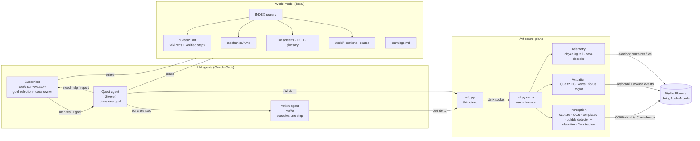
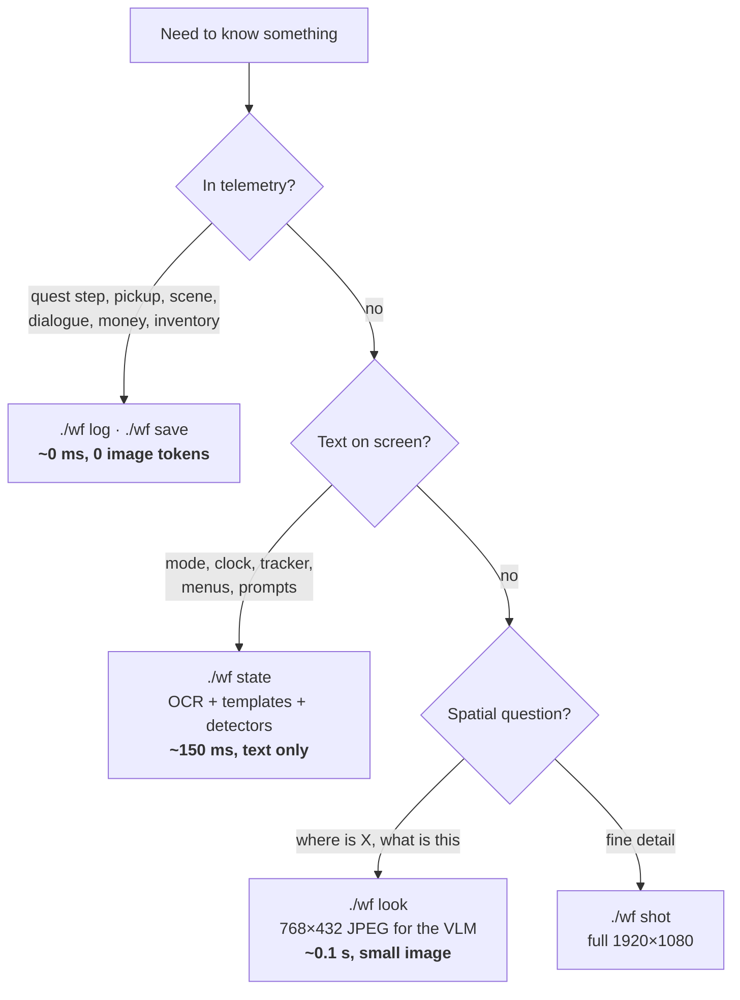
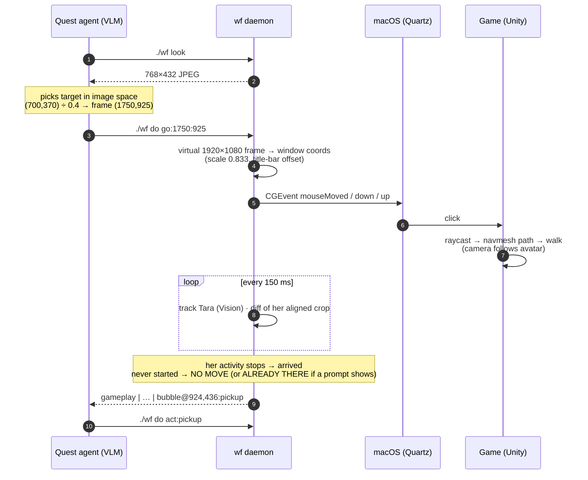
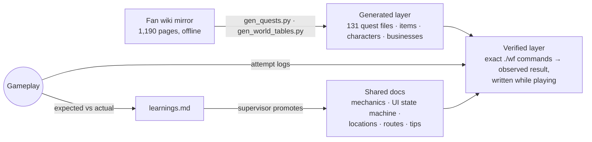
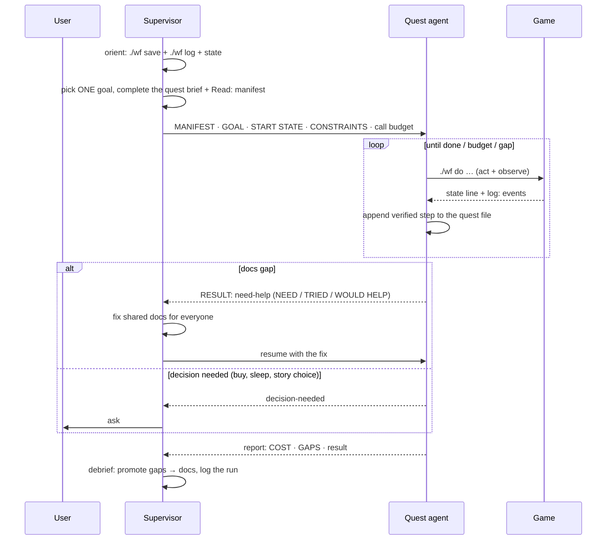
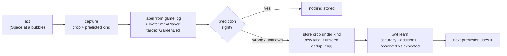

# Autonomous LLM agents playing Wylde Flowers

**A hierarchical multi-agent system (Claude Code) that plays a commercial 3D life-sim on macOS end to end.** It
perceives the game through screen capture, OCR and the game's own telemetry, acts through synthesized OS input
events, and plans against a curated, progressively loaded **world model** that the agents extend while they play.

The game has no API, mod support or accessibility hooks. Everything goes through the same pixels and input devices a
human uses, plus side channels found by reverse-engineering the sandboxed app container.

<p align="center">
  <br>
  <sub>A quest agent on <i>The Most Elaborate Icebreaker</i>: <code>go:</code> click-to-move hops across the town square
  into Seton's Bakery, dialogue with Angus, the villager tracker ticking to 5/22, and back out (2× speed). The caption is the live <code>./wf</code> call.
  <b><a href="docs/media/quest-1.mp4">Full video (MP4, 72 s)</a></b></sub>
</p>

---

## Highlights

| Area | Technique | Effect (measured) |
|---|---|---|
| **Perception cost** | Observation ladder: game **telemetry (log + save) → OCR text state → low-res vision → full screenshot** | **Outcome verification is text-only** (quest/goal, pickups, scene, mode, prompt). Images are used only for spatial targeting: one ~768×432 JPEG per navigation hop instead of a 1920×1080 screenshot |
| **Telemetry side channel** | Live tail of Unity `Player.log` + decoding of the zstd-JSON autosave; ids resolved by **CRC32 reverse lookup** over strings mined from the app's asset bundles | Exact quest/goal state, inventory, money, position, dialogue lines; 413/428 hashed ids decoded |
| **Navigation** | **Click-to-move with the engine's own pathfinding** (`go:x:y`), mouse only; arrival from a **character-scoped motion tracker** (Apple Vision object tracking + aligned crop differencing) | Approaching a target: **3–6 calls → 1**; arrival detected 1–2 s after Tara stops, immune to water, NPCs and camera pans |
| **Prompt understanding** | Two-stage prompt recognition: colour/blob detector finds the bubble, **Vision feature-print embedding + nearest-neighbour** over labelled crops names it (`pickup`, `axe`, `talk`…), orange-ring test for "highlighted"; `act:<kind>` presses only on a match | Leave-one-out **41/41** on kinds with ≥2 refs; **~10 ms** extra per state read; 0 image tokens for the model |
| **Latency** | Warm daemon over a Unix socket, in-memory capture, half-res OCR, run-loop-pumped focus detection | Focus switch **3.16 s → 0.22 s**; `state` ≈ **0.15–0.2 s**; a full act+observe step ≈ **2.3 s** (was 6–8 s) |
| **Reasoning** | Curated **world model** (131 quests, mechanics, UI state machine, locations, routes) loaded **progressively** through a manifest | Each agent loads only the 3–6 files its goal needs |
| **Orchestration** | **Supervisor → quest agent → action agent** hierarchy with a manifest protocol and `need-help` escalation | Gaps fixed once in shared docs, then reused by every later agent |
| **Self-improvement** | **Self-labelling from game telemetry**: the logged interaction (`> water me=Player target=GardenBed`) labels the prompt crop, unseen ones create new classes, only disagreements are stored; an **actions DB** of expected outcomes (hits, drops, energy) checked against observed ones; every surprise becomes a learning + fix | 56 learnings; failed run (25 calls) → same task in 4 calls after the fix |
| **Observability** | Structured **run logs** per task (attempts, issues, calls, Tara's walk/act segments, game events) + **idle analysis** (still screen split into "command running" vs "agent thinking") + captioned recordings | Retros start from numbers: e.g. 53% of a run's wall time was agent turns between calls |

---

## System architecture



---

## 1. Perception: the cheapest signal first

LLM tokens and wall-clock time are the scarce resources, so observation goes up a **cost ladder**. The agent stops at
the first rung that answers its question.



### Text state in one line
Every act call returns a compressed **state line** produced by a frame classifier:
```
gameplay | Thursday 8:10 am | 42c | ⚡94% | bubble@924,436  [settled 0.6s]
log: [D4 9:46:59 AM] [STATS] game.CharactersMet = 5
```
| Signal | Method |
|---|---|
| Mode (`gameplay / dialogue / popup / cutscene / overlay`) | Letterbox luminance test, fixed-position **HUD template matching** (mean abs diff), subtitle-band OCR, popup keyword match |
| Clock, money, quest tracker | Apple **Vision** `VNRecognizeTextRequest` on the full frame at 0.5× (3.5× faster and *more* accurate than full-res for this font) plus a full-res crop for the small clock text |
| Energy | Polar sampling of the HUD energy arc (no OCR) |
| Interaction prompt: where | **Colour thresholding + connected-component labelling** for the round cream bubble on a 1/4-scale mask (no model, ~25 ms) |
| Interaction prompt: what | 140 px crop → Apple Vision **feature print** (768-d embedding, ~5 ms) → **nearest neighbour** over `tools/bubbles/<kind>/*.png` (distance > 0.6 = `unknown`); ring colour → highlighted. State line: `bubble@x,y:pickup` / `:axe(dim)` |
| Tara's motion | Vision `VNTrackObjectRequest` seeded at the camera centre + **aligned crop difference** (±3 px best match cancels box jitter and slow pans): idle ≤ 5.5, walking 15–43 |
| Transient toasts ("Mushroom: 1/2") | Frames buffered during the settle wait are OCR'd afterwards and reported as `saw:` |

### Telemetry side channel (reverse-engineered)
The macOS sandbox container holds two files most automation ignores:
- **`Player.log`**: a live Unity log with quest transitions (`[QUEST] Advance quest GrandmaFaveFood to goal 1`),
  triggers (`OnGoalReady`, `OnEnterBuilding Baker`), every dialogue line, pickups with world coordinates, stats and
  relationship deltas. `wf` tails it incrementally (inode + offset cursor, noise filter) and adds the new lines to every
  act call.
- **Autosave**: a zstd-compressed JSON document. Names are stored as **signed CRC32 hashes**. `wf` builds a
  reverse-lookup table by running `strings` over the app's asset bundles and hashing every candidate (one-off, ~25 s,
  cached), then decodes quests and goal counters, inventory, stamina, money, scene and player transform.

Result: "did that work?" is answered from **structured ground truth** instead of a vision call. Vision is still
needed for *where* questions: each navigation hop costs one model turn plus one small look image (see §2, Limits).

---

## 2. Action: from dead reckoning to engine pathfinding

Movement used to be the main source of wasted calls. Keyboard walking is **open-loop dead reckoning**: key-hold
jitter, a ~0.21 s acceleration ramp, perspective foreshortening and silent collisions all add up, so agents
oscillated in front of targets.

The fix exploits the game's touch-port heritage: **a left click on the world issues a navmesh path request**. The
engine plans around obstacles, and clicking an interactable stops the avatar at its interaction pose with the prompt
shown.



| | Keyboard dead reckoning | Click-to-move (`go:`) |
|---|---|---|
| Control | Open loop, `walk:dir:seconds` | Engine navmesh pathfinding |
| Obstacles | Detected after the bump (`BLOCKED` via frame diff) | Planned around (fences, gate gaps) |
| Typical approach | 3–6 calls (walk, look, nudge…) | **1 call** + Space |
| Failure signal | Silent drift | `NO MOVE` / `ALREADY THERE` / `STILL MOVING` |

**Mouse only.** Keyboard walking is disabled in the tool: an agent that fell back to WASD after ambiguous `NO MOVE`s
got stuck between café booths and burned its budget. `go:` now separates "not walkable" from "already there".

### Character-scoped motion
Whole-screen pixel change is a bad "is she moving?" signal: water, NPCs, camera pans and slow zooms move pixels while
Tara stands, and a tool swing barely changes them. The tracker follows **only Tara** (Apple Vision object tracking,
seeded at the camera centre, which follows her) and compares her crop to the previous frame after a ±3 px alignment.
`go:` returns when *her* activity stops; the recorder writes the same signal per frame for post-run analysis.

**Limits / next step.** Each hop is still a model turn: look → pick a pixel → `go:`. Targets off screen need a chain
of hops, and each needs a fresh look because the camera moves. Planned: store verified hop chains for known places
(like `routes/`, but as click targets relative to landmarks) so a known trip replays in one call without images, and
reserve vision for unknown places.

Before click-to-move was found, a **visual-odometry** fallback was prototyped: FFT phase correlation between
consecutive frames to measure camera displacement (the camera is avatar-locked, so background shift = avatar motion),
calibrated to ~610 px/s after a 0.21 s ramp, for closed-loop servoing toward a target pixel. It's kept as a
design option for scenes where clicking isn't possible.

### Resolution-independent coordinates
All tools work in a **virtual 1920×1080 frame**. Captures are cropped (title bar) and rescaled into it; clicks are
mapped back through `content_box()`. Coordinates recorded in docs stay valid whether the game runs fullscreen or in a
1600×900 window.

---

## 3. Latency engineering

```mermaid
gantt
    title One act+observe step, before vs after (seconds, approximate)
    dateFormat X
    axisFormat %s
    section Before
    Space switch to fullscreen game :0, 4
    Input + settle                  :4, 5
    Switch back + OCR (cold-ish)    :5, 7
    section After
    Focus (run-loop pumped)         :0, 1
    Input + settle                  :1, 2
    State (warm OCR)                :2, 3
```



| Bottleneck | Root cause | Fix | Result |
|---|---|---|---|
| Cold start | Python import + Vision model load per CLI call | **Warm daemon** behind a Unix-socket thin client | Saves ~5 s on the first OCR in a process; `state` ≈ 0.2 s |
| Focus detection | `NSWorkspace.frontmostApplication` is only refreshed when the **run loop is pumped**; polling never saw the change | Pump `NSRunLoop` for 5 ms per poll | **3.16 s → 0.22 s** |
| Fullscreen Space slide | macOS Space-switch animation | Windowed mode + virtual frame | Step **6–8 s → 2.3 s** |
| Screenshot I/O | PNG encode/decode, 0.5–1.2 s | In-memory `CGImage → PIL` | ~30 ms per capture |
| OCR | Full-res recognition | 0.5× downscale (sweet spot for this UI font) | 3.5× faster, more accurate |
| Fixed sleeps | `sleep(2)` after every action | **Change detection**: 2 consecutive still frames on a 96×54 signature | Waits only as long as the screen moves |
| Game time | The game clock runs while the agent "thinks" | Explicit **focus policy** (`front` = time runs, `background` = engine pauses when unfocused) + batching several actions per call | Simulation time becomes a managed resource |

---

## 4. Reasoning: a world model built for agents

Agents don't get the raw wiki. They get a **curated, layered world model** designed for small context windows:



- **Progressive disclosure:** `docs/INDEX.md` → topic index → one file. Every file starts with a one-line
  `> **Summary:**`, so `head -8` is often enough to decide whether to read on.
- **Two kinds of knowledge per quest:** wiki requirements (generated, regenerable) and **verified steps** (observed,
  preserved across regeneration by marker blocks).
- **UI as a state machine:** each screen doc lists *Recognise → Elements → Actions → Exit*, keyed on the classifier's
  `mode`.
- **Grounding ids:** each quest file carries its internal engine id (`MayorMeetEveryone`, `GrandmaPotato`), so plans
  are checked against telemetry, not prose.
- **Localization-robust:** the game UI was switched from Russian to English mid-project. The docs were migrated with
  a confidence-tagged glossary (✅ seen in-game / ❓ translated, unverified), so agents know which strings to trust.

---

## 5. Orchestration: hierarchical agents with a manifest protocol



**Design choices**
- **Model tiering:** planning on a mid-size model, mechanical execution on a small one, supervision and doc
  ownership in the main session.
- **Manifest protocol:** the parent passes every file the child needs. A missing source is treated as a docs bug,
  not as something the agent should guess.
- **Hard call budgets** and a **no-progress rule** (3 calls without progress → stop) limit runaway loops.
- **Human-in-the-loop gates** for irreversible or preference-laden actions (spending, sleeping, story choices).
- **Single writer for shared docs:** agents write raw attempt notes, and the supervisor promotes them. This avoids
  concurrent-edit drift.

---

## 6. Closing the loop: measurable self-improvement

Every run is logged in [`docs/agent-runs.md`](docs/agent-runs.md) with calls spent, game time, top lesson and the
fix applied. Examples:

| Run | Before the fix | Root cause | Fix | After |
|---|---|---|---|---|
| Forage 2nd mushroom | ❌ ~25 calls, no pickup | Blind micro-nudges, Space without a prompt, silent collision | *Approach-a-target* procedure + `BLOCKED` detection + no-progress rule | ✅ **4 calls** |
| Wood hand-in | partial, budget hit (25) | 7 doc gaps (NPC routes, interior layout, hand-in icon) | Docs + brief template | ✅ ~5 calls to reach the NPC |
| Cooking quest | `need-help`: stove said "Not yet" | Goal state machine: `OnGoalReady` means report to the giver first | Telemetry doc + brief | ✅ quest completed |
| Approach any object | 3–6 calls | Keyboard dead reckoning | Click-to-move `go:` | **1 call** |
| Gather 26 stone | 9 short, ~7 stone left on the ground | Agent had no expected outcome per action | **Actions DB** (hits, drops, energy, verify signal) | quest materials complete next run |
| Leave a café | stuck, budget gone | Keyboard fallback after ambiguous `NO MOVE` | Mouse only + `ALREADY THERE` | — |
| Talk to Parker | ~15 calls, talked to his kids | Space fires the nearest prompt, icons unread | Bubble kinds + `act:<kind>` | — |

### Self-labelling skills
Skills that recognise things learn from play with no human labels. The **game log is the ground truth**:



The same loop compares the actions DB's expected hits/drops with what run logs observed (`./wf learn`). Method:
[`docs/self-improvement.md`](docs/self-improvement.md).

### Run logs and idle analysis
Each task writes `runs/<date>-<quest>.jsonl`: the agent adds attempts, issues and decisions, and the tools add
every call (start/end), Tara's walk/action segments and key game events. `./wf run report` prints the timeline and
a time split. `tools/idle.py` lines a recording's Tara-activity track up with the calls and splits still time into
"command running" vs "agent thinking". On the ranch run: Tara active 9% of wall time, **agent turns 53%**; the next
optimisation target is fewer, higher-level turns.

---

## Repository map

| Path | What |
|---|---|
| [`AGENTS.md`](AGENTS.md) | Operating rules for agents (start here) |
| [`tools/wf.py`](tools/wf.py) | Control plane: capture, OCR, classifiers, input, telemetry, `do` / `go` / `advance` |
| [`tools/wfc.py`](tools/wfc.py) | Thin client for the warm daemon; logs every call for replay captions |
| [`tools/record.py`](tools/record.py) | Game-window recorder (H.264, command captions, Tara-activity + game-event tracks) |
| [`tools/idle.py`](tools/idle.py) | Post-run analysis of visible non-doing time |
| [`tools/bubbles/`](tools/bubbles) | Labelled prompt crops (the classifier's memory; grows itself) |
| [`docs/actions.md`](docs/actions.md) | Actions DB: recipe → expected outcome → verify signal → fix (`./wf actions <tags>`) |
| [`docs/self-improvement.md`](docs/self-improvement.md) | The self-labelling loop |
| [`runs/`](runs) · [`retros/`](retros) | Run logs per task and retrospectives built from them |
| [`docs/`](docs/INDEX.md) | World model: quests, mechanics, UI, world, learnings, run ledger |
| [`.claude/agents/`](.claude/agents) · [`.claude/skills/`](.claude/skills) | Agent definitions and skills (supervise, play, navigate, lookup) plus a generic **game-onboarding** skill for applying the method to other games |
| [`routes/`](routes) | Old keyboard routes (disabled; their notes still describe landmarks) |

## Running it
macOS with the Apple Arcade build of Wylde Flowers. Grant the terminal **Screen Recording** and **Accessibility**.
Create `.venv` with pyobjc (Quartz, Vision, Cocoa), Pillow, numpy, zstandard and imageio-ffmpeg. Then:
```bash
./wf status                     # permissions, window, daemon
./wf state                      # one-line classified state
./wf do go:1750:925 act:pickup  # walk via engine pathfinding; press Space only if the prompt is a pickup
./wf actions rock pickup        # expected outcomes for a job
./wf run start <quest> <goal>   # … ./wf run issue <text> … ./wf run end done; ./wf run report
./wf learn                      # self-improvement status
./wf log --tail 20; ./wf save   # telemetry
.venv/bin/python tools/record.py start   # … play … then: record.py stop; tools/idle.py <video>
```

## Credits / licences
- Wylde Flowers is © Studio Drydock. This is an unofficial research/fan project, not affiliated with or endorsed by
  them.
- `reference/wiki/` and the generated tables in `docs/` come from the Wylde Flowers fan wiki (Fandom), licensed
  **CC BY-SA 3.0**, and stay under that licence.
