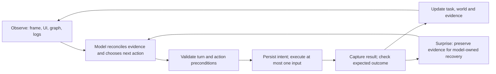

# An AI agent that plays Wylde Flowers

**A hands-on project in visual AI agents, persistent memory, action verification and learning from live failures.**

This project explores how an AI agent can operate a real game, remember what it has learned, and improve its own
ability to play. The test bed is *Wylde Flowers*, a commercial game running on macOS. The agent observes screenshots, sends
ordinary mouse and keyboard input, and reads game logs and decoded saves as additional evidence.

Tasks include navigating between locations, tending garden beds, interacting with characters and using shops.
The engineering work combines language and vision models with local perception, a world graph, durable task state
and an instrumented execution loop. Development happens through live attempts, recorded failures, code changes and
verification.

The goal is faster, more reliable gameplay with less human intervention. This is an experimental agent toolkit;
reliable unattended play remains work in progress. It improves the agent's behaviour, not the game itself.

## The engineering problem

A plausible model answer is only the beginning. A practical agent must also handle:

- ambiguous visual evidence and objects that look alike;
- delayed animations, changing screens and stale coordinates;
- interrupted tasks that must resume without repeating a purchase or losing an interaction phase;
- actions whose delivery is uncertain after a timeout;
- apparent success contradicted by application evidence;
- corrections that help one case but may regress another.

These issues surfaced during navigation, gardening and shop interactions. They led to a design that records intent
before execution, preserves evidence around each action, and separates proposed outcomes from verified outcomes.

## What is implemented

The current public gameplay entry point is a **model-owned turn loop**. Local code gathers clues and may recommend
an action; the gameplay model explicitly chooses each continuation. An observation returns `NEXT` without issuing
input. A versioned decision can execute at most one guarded input.



| Capability | Implementation and purpose |
|---|---|
| Model-owned decisions | [play.py](tools/game/play.py) and [turn.py](tools/game/turn.py) expose observations, accept explicit decisions and guard execution. The model is not merely an exceptional vision fallback. |
| Durable task state | [task_state.py](tools/game/task_state.py) persists the active target, interaction phase, crop, nested subgoals and pending intent, using the SQLite runtime store. |
| Grounded perception | OCR, Apple Vision feature prints and DINOv2 patch embeddings provide text, visual matches and object candidates. Labelled examples live in local vector stores. |
| World and navigation memory | Object state, containment and relations live in a graph. [navigation.py](tools/game/navigation.py) supplies walkable graph paths, qualitative localization, compass/range hints and progress checks for model-selected waypoints. |
| Action verification | [primitives.py](tools/game/primitives.py), [experience.py](tools/game/experience.py) and [integrate.py](tools/game/integrate.py) connect actions to observations, verification checks and replayable updates. |
| Transport uncertainty | [wfc.py](tools/wfc.py) avoids automatically resending a request when it may already have reached the daemon. A timeout is not treated as proof that nothing happened. |
| Human-readable audit trail | Each run has timestamped decisions, results and corrections in `decisions.md`, generated from the canonical SQLite timeline. Navigation entries include graph and compass evidence. |
| Evaluation tooling | Component hit/miss records, replay tests, benchmark tooling and SQLite-backed live navigation evaluations record outcomes and timing. |

Visual similarity identifies an appearance or kind; it does not prove the identity of one of several identical beds.
Positioned game events and other scoped evidence bind interactions to actual objects. Save-derived facts carry
provenance because an autosave can lag behind the live screen.

Transition tables remain available as knowledge and recommendation inputs. Older scheduler code and historical
specifications also remain in the repository; they should not be mistaken for the current public execution contract.

## Learning without trusting every model answer

The system distinguishes several kinds of correction:

1. **State:** apply a verified event to the current world or interaction.
2. **Perception:** add a labelled appearance example or correct a mistaken match with supporting evidence.
3. **Behaviour knowledge:** record transition observations and revise expectations when outcomes disagree.
4. **Implementation:** preserve a gap for an offline code change, replay and live verification.

The integration boundary journals applied updates so replay need not teach the same experience twice. Runtime code
does not rewrite itself during an action. Model explanations are useful hypotheses; application evidence determines
what can be recorded as verified.

For example, a purchase requires matching inventory and money evidence. A refused click must remain distinguishable
from a click that reached the game but failed. An interrupted gardening task must retain its target and phase while
resolving a surprise. These are constraints on agent execution, not prompt-only requests to “be careful.”

## Engineering lessons from the project

The work goes beyond asking a model where to click. Several recurring problems have shaped the implementation:

- **Recognition and identity are different.** An embedding can recognise a bed, but distinguishing identical beds
  needs location and interaction evidence. Visual candidates and confirmed object identity are kept separate.
- **Movement is not arrival.** A click can move the character without advancing the route. Navigation needs a
  current location hypothesis, a next objective and evidence of progress toward that objective.
- **A timeout creates uncertainty.** Retrying an input whose delivery is unknown can repeat an interaction. Pending
  intent and observed results must be reconciled before another action.
- **Memory needs provenance and scope.** Facts from another save profile, stale screenshots or earlier interactions
  can produce convincing but incorrect decisions. The runtime records observation identity and save lineage.
- **Latency needs attribution.** Capture, perception, persistence, action settling and external model/tool gaps must
  be measured separately before choosing what to optimise.

These problems provide practical experience in building and debugging agents that interact with a changing
environment. The code and run evidence are the case study; no production deployment or business outcome is implied.

## Current architecture and experimental work

The intended gameplay owner is one model-capable agent that handles observation, decisions and recoverable surprises
through a task. It receives a bounded receipt containing the current full-scale frame, visual candidates, relevant
world facts and the previous action result. The runtime persists decisions and executes primitives; it does not
contain a self-sufficient local model player.

Navigation uses graph connectivity and qualitative directions/ranges. The gameplay model updates its current
semantic location and next objective from current evidence. Those beliefs are short-lived; stored route knowledge
does not turn an old screen coordinate into a valid new click.

An experimental [native bridge](tools/game/native_bridge.py) exposes observation, action and note operations through
the same durable turn boundary. [Host-facing packaging](tools/native_tools.py) returns bounded text and the saved
frame. This is an alternative interface under evaluation, not a completed replacement for the gameplay workflow.
The [documented live trial](docs/testing/INDEX.md) exercised transport and movement but did not complete leaving the
House. Its receipt distinguishes physical movement from verified navigation progress.

The project also includes SQLite-backed live navigation evaluations and timing instrumentation. The
[requirements](requirements.md) set a three-second end-to-end turn budget; that is a target, not a demonstrated
performance claim. [Timing reports](tools/owner_timing.py) distinguish measured runtime phases from host/model
subdivisions that remain unmeasured without a host trace.

## Current status and limits

- **Implemented:** the Python/macOS gameplay toolkit, model-owned turn protocol, durable interactions, visual
  memories, graph/navigation evidence, verification and logging infrastructure.
- **Validation:** historical live demonstrations and offline tests exist. Some current universal workflows still
  list live verification as pending. This README makes no claim of unattended production reliability or a measured
  end-to-end success rate.
- **Research directions:** local Qwen inference, RxInfer belief models and Laya-like specialists have been discussed.
  They are not integrated into the current runtime. Their value needs comparative measurement before adoption.

The current stack is Python, macOS Quartz/Apple Vision through PyObjC, NumPy, PyTorch/DINOv2 and SQLite runtime
state. An external model-capable agent drives gameplay turns; installing the repository does not provision a local
model or start an autonomous cloud agent.

## Inspect or run the project

The test bed requires macOS, *Wylde Flowers*, Python 3.12+, `uv`, Screen & System Audio Recording permission and
Accessibility permission. The wrapper uses the repository's virtual environment.

```sh
uv sync
./wf status
./wf world kinds
```

For a model-driven run, create a task directory and review its plan before continuing:

```sh
./wf run start garden-demo "Inspect and maintain the garden"
./wf play garden region=Garden
```

The second command observes and returns `NEXT`; it does not automatically complete gardening. The model reads the
current frame and evidence, then supplies a decision with the exact returned `turn_id`. Read the
[gameplay workflow](.claude/skills/wylde-play/SKILL.md) and
[action contract](.claude/skills/wylde-play/actions/INDEX.md) before issuing a continuation.

Check the current source-specific game clock before gameplay and follow the active deadline and human-handoff
rules in [AGENTS.md](AGENTS.md), [requirements.md](requirements.md) and the gameplay workflow. Spending, sleeping
and story choices follow the user's task scope.

Structured runtime state is local and git-ignored in `runs/wf.sqlite3`; task directories hold human-readable
projections and media:

```text
runs/wf.sqlite3   authoritative runs, tasks, observations, intents, experiences and world overlays
runs/<timestamp>-<task>/
  plan.md          task plan
  decisions.md    generated timestamped observation, decision, outcome and correction summaries
  progress.md     generated step timestamps and budget tracking
  retro-N.md      run-local retrospective
```

Runtime recovery reads SQLite, not Markdown or legacy run-local JSON files. JSONL is available as an explicit
`./wf run export --jsonl <run>` diagnostic export. See the [runtime store](docs/architecture/runtime-store.md).

Read summaries with `./wf run status`, inspect component evaluation with `./wf eval`, and compare recorded benchmark
runs with `./wf bench compare`. These commands expose evidence; they do not by themselves establish reliability.

## Repository guide

| Area | Start here |
|---|---|
| Runtime storage | [runtime-store.md](docs/architecture/runtime-store.md), [schema.py](tools/runtime/schema.py), [world_store.py](tools/game/world_store.py) |
| Public gameplay loop | [play.py](tools/game/play.py), [turn.py](tools/game/turn.py), [task_state.py](tools/game/task_state.py) |
| Guarded actions and verification | [primitives.py](tools/game/primitives.py), [experience.py](tools/game/experience.py), [integrate.py](tools/game/integrate.py) |
| Perception and world memory | [observe.py](tools/game/observe.py), [objects/](tools/objects), [world.py](tools/game/world.py) |
| Navigation evidence | [navigation.py](tools/game/navigation.py) |
| Runtime and transport | [wf.py](tools/wf.py), [wfc.py](tools/wfc.py), [runtime/](tools/runtime) |
| Experimental native gameplay bridge and timing | [native_bridge.py](tools/game/native_bridge.py), [native_tools.py](tools/native_tools.py), [owner_timing.py](tools/owner_timing.py) |
| Evaluation | [testing guide](docs/testing/INDEX.md), [live_eval.py](tools/runtime/live_eval.py), [evals/](tools/evals), [bench/](tools/bench), [turn tests](tools/test_turn.py), [play tests](tools/test_play.py) |
| Operations and game knowledge | [Docs index](docs/INDEX.md), [Wiki index](wiki/INDEX.md), [operating instructions](AGENTS.md) |

## Credits and licences

- *Wylde Flowers* © Studio Drydock. This is an unofficial research project, not affiliated with or endorsed by
  Studio Drydock.
- Imported material in `wiki/` derives from the game's fan wiki (Fandom); CC BY-SA 3.0 attribution is retained.
