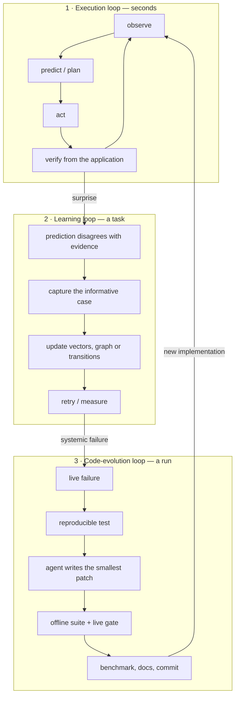
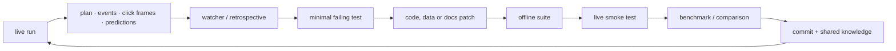

# A self-evolving AI agent for software with no automation API

This project explores a question: **how can an AI system operate unfamiliar software, learn from the application’s
feedback, and improve its own implementation when it fails?**

The test bed is *Wylde Flowers*, a commercial 3D macOS game with no public automation API, plugin system or
accessibility tree. The agent sees the window, sends ordinary mouse and keyboard events, and reads reverse-engineered
log and save files as ground truth.

It is not one giant vision model clicking pixels. It is a hybrid AI system with:

- local perception from NumPy, OCR, tracking and pretrained vision embeddings;
- a persistent world graph and a learned transition model;
- an LLM/VLM used at uncertainty boundaries rather than on every frame;
- an outer agentic code factory that turns live failures into tests, patches and another measured run.

   
  A quest agent at work (2× speed). The caption is the live tool call.
  <b><a href="docs/media/quest-1.mp4">Full video (MP4, 72 s)</a></b>

---

## Three nested feedback loops

The central architectural decision is to separate intelligence by timescale.

### 1. Execution loop

The fast loop is closed around evidence:

**observe → plan → act → verify**

Routine perception is local and cheap. The controller acts once, captures the result immediately, and changes its
world state only when the game proves the expected outcome. If evidence is missing or contradictory, it stops instead
of inventing an explanation.

### 2. Learning loop

The runtime stores information where it was wrong or uncertain:

- an unknown prompt becomes a labelled vector example after the game event names its action;
- a clicked object can be relabelled when the event proves its real kind;
- a model answer can name a previously unknown crop icon or state;
- repeated observations can add or revise a transition;
- successful movement teaches a relation between graph nodes.

Correct, familiar cases are mostly discarded. Disagreements carry the useful information.

### 3. Code-evolution loop

Some failures are not missing data; they expose a wrong abstraction or algorithm. Those enter an outer loop:

1. Every task starts from a reviewed plan with explicit signals, budgets and stop conditions.
2. Every click records the before/after frames, bubbles, movement, screen text and new engine-log lines.
3. A live watcher raises STOP or ALERT at the first unsafe click, prediction miss or broken expectation.
4. The run artifact preserves the exact evidence; benchmark reports also record the toolkit revision.
5. A coding agent turns the failure into a failing offline test.
6. The agent changes code, data or documentation at the smallest responsible layer.
7. Offline tests run before one-object live smoke tests and repeatable benchmarks.
8. Only verified changes are committed; the new behavior becomes the next runtime.

This is **agent-assisted self-evolution**, not uncontrolled hot-patching. The gameplay process never rewrites its own
code during an action. Code changes pass tests and live gates under supervisor control.

---

## Persistent intelligence: graph, vectors and transitions

An LLM context window is not the world model. Durable state lives outside the model in three complementary forms.

| Memory | What it represents | Why it exists |
|---|---|---|
| **World graph** | object identity, kind, state, area and learned relations | Keeps “what exists and what is true now” separate from pixels and prose |
| **Vector memories** | what prompts, objects, items and crop icons look like | Turns a new labelled example into immediate recognition without retraining |
| **Transition table** | when an action applies, its checked steps, effect, needs and proof | Makes behavior inspectable, composable and learnable |

### World graph

The save contains hundreds of positioned records with opaque prefab identifiers. The graph names objects from state
fields or live events, clusters nearby objects into areas, and applies events newer than the last save.

Kinds and states are properties, not hard-coded branches. A goal is a graph query for objects whose state should
change. The graph answers:

- Which objects match this goal?
- Which area contains them?
- What is known, stale or still unnamed?
- Which object did the last event actually affect?
- Which relation or area should navigation try next?

The graph provides memory and constraints; it never overrides fresh evidence from the screen or game log.

### Vector memories

The system uses pretrained encoders as reusable perception:

- **Apple Vision feature prints** produce 768-dimensional embeddings for prompt, item and crop-icon recognition.
- **DINOv2-small** produces 384-dimensional patch embeddings for object heatmaps.
- Small NumPy-backed nearest-neighbour stores hold labelled examples and reject distant matches as unknown.

The graph and vectors solve different problems:

    vector memory: “this looks like a GardenBed”
    graph memory:  “this is a bed in GardenSouth, currently ready”

Visual identity is generally tied to graph kinds. Individual identity comes from relations and application evidence,
not from pretending an embedding can distinguish every look-alike instance.

### Transition model

Actions are data:

    current state → visible affordance → checked steps → effect
                                             └──────── proof

The planner performs breadth-first search over effects. Preconditions become subgoals. If watering discovers an empty
can, the same planner finds a transition that makes the can full, reaches the well, verifies the fill event and then
returns to watering.

A learned transition is not trusted after one lucky observation. It needs repeated agreement; repeated
contradictions revise the expectation and are reported as surprises.

---

## Where the models fit

| Component | Responsibility |
|---|---|
| **Local vision** | Segment prompts, read UI text, track the avatar and retrieve visual examples |
| **Goal engine** | Query the graph, choose transition paths, create subgoals and demand proof |
| **VLM fallback** | Answer one typed uncertainty: a click cell, button name or object/state name |
| **Task agent** | Select or write the goal, interpret evidence and manage a bounded run |
| **Supervisor** | Gate decisions, watch safety signals, own shared knowledge and drive code evolution |
| **Coding agent** | Convert a captured failure into a test, patch and verification result |

The model is deliberately removed from high-frequency control. It does not repeatedly describe the whole screenshot.
Most frames become structured observations; model vision receives only the unresolved question and the evidence
needed to answer it.

Each vision question carries a pending record with its goal, parameters, transition and failed step. The answer is
therefore applied to the uncertainty that produced it, rather than becoming unscoped chat advice.

---

## Architectural decisions

### Ground truth beats confidence

The application log and decoded save are treated as supervision:

- log events prove interactions, pickups, dialogue, scenes, quests and object positions;
- the save supplies inventory, quests, resources and object state;
- cards and bubble changes fill short-lived gaps.

For example, the game can emit a plant event when the picker closes even if planting was cancelled. The system
therefore requires the totalPlanted statistic before changing the graph. A confident visual prediction is weaker than
the application’s own evidence.

### Uncertainty is a typed interface

“Ask the model” is not a general escape hatch. The engine may ask exactly one question of one type:

- **click** — which visible object or safe ground cell to use;
- **button** — which on-screen control continues the expected transition;
- **name** — what an unknown icon or state change represents.

The run stops after repeated unproductive questions. Unknown is a valid state, not permission to guess.

### Data before code

The smallest correction wins:

1. add a visual example;
2. update graph state or a relation;
3. add or revise a transition;
4. clarify shared knowledge;
5. change code only when the abstraction is wrong.

This keeps self-improvement inspectable and prevents every new object or chore from becoming another special-case
function.

### Fail closed and preserve evidence

World clicks are allowed only in gameplay. Cards are closed only through known screen rules. User decisions such as
spending, sleeping or irreversible story choices remain gated. Every failure keeps the frame that existed before
cleanup, so diagnosis starts from evidence rather than from the agent’s story about what happened.

---

## The code factory

The repository is also the production line for the next version of the agent:

The hierarchy separates responsibilities:

- the **supervisor** owns the current goal, plan, safety gates and final integration;
- a **task agent** owns one bounded goal and reports gaps rather than improvising;
- an **action agent** executes one concrete step with a small model and a hard call budget;
- the **watcher** independently evaluates clicks, predictions and terminal conditions;
- tests use a fake game whose behavior is independent of the transition table, avoiding circular “tests” that merely
  repeat the implementation’s assumptions.

Run logs, retrospectives and benchmarks make evolution measurable. A fix is not “better” because an agent says so; it
must remove a reproduced failure without regressing the existing corpus.

---

## Evidence from live evolution

The architecture emerged from real failures:

- A second garden that no code knew about appeared from save records as a new graph area with 12 beds.
- The generic engine planted all 12 beds using transition proofs rather than a garden-specific loop.
- An empty watering can became a planned fill-can subgoal and then returned to the original goal.
- A hive’s ready marker was initially mistaken for a ready crop; ownership constraints now bind affordances to kinds.
- Crop identity was absent from the save, so ready-bubble icons gained their own vector memory and typed naming
  question.
- Dusk icons, stale daemon code, unsafe Escape behavior and unexpected cards each produced tests and narrower safety
  rules.

The important result is not that the agent finished one chore. It is that failures changed the reusable system:
perception memory, world representation, transition knowledge, tests and agent instructions all evolved together.

---

## Boundaries

- There is no public automation API, but the system does use reverse-engineered read-only log and save side channels.
- The neural encoders are pretrained; the project learns memories and symbolic behavior, not a foundation model.
- The code factory is supervised and gated. It does not modify production code during gameplay.
- Icon-dependent work stops outside reliable lighting.
- Long navigation may still require one model-provided direction.
- Spending, sleeping and irreversible story decisions remain human decisions.

---

## Repository map

| Layer | Main paths |
|---|---|
| Runtime brain | [tools/game/engine.py](tools/game/engine.py), [world.py](tools/game/world.py), [plan.py](tools/game/plan.py), [actions.json](tools/game/actions.json) |
| Perception and vector memory | [tools/game/observe.py](tools/game/observe.py), [tools/objects/](tools/objects), [tools/game/icons.py](tools/game/icons.py) |
| Evidence and learning | [tools/game/act.py](tools/game/act.py), [learn.py](tools/game/learn.py), [ask.py](tools/game/ask.py) |
| Control plane | [tools/wf.py](tools/wf.py), [tools/wfc.py](tools/wfc.py) |
| Code factory | [tools/runwatch.py](tools/runwatch.py), [tools/evals/](tools/evals), [tools/bench/](tools/bench), [retros/](retros) |
| Shared knowledge | [docs/](docs/INDEX.md), [docs/self-improvement.md](docs/self-improvement.md), [AGENTS.md](AGENTS.md), [.claude/](.claude) |

## Try it

    uv sync
    ./wf status
    ./wf world kinds
    ./wf achieve water
    ./wf eval
    ./wf learn

The current test bed requires macOS, *Wylde Flowers*, Screen & System Audio Recording permission and Accessibility
permission.

---

## Credits and licences

- Test bed: *Wylde Flowers* © Studio Drydock. This is an unofficial research project and is not affiliated with or
  endorsed by Studio Drydock.
- reference/wiki/ and generated tables under docs/ derive from the game’s fan wiki (Fandom), CC BY-SA 3.0.
