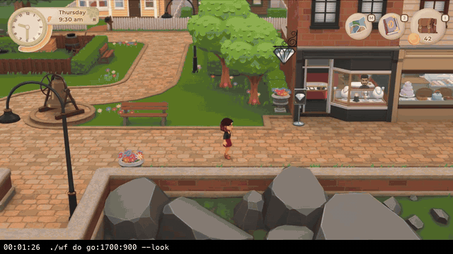
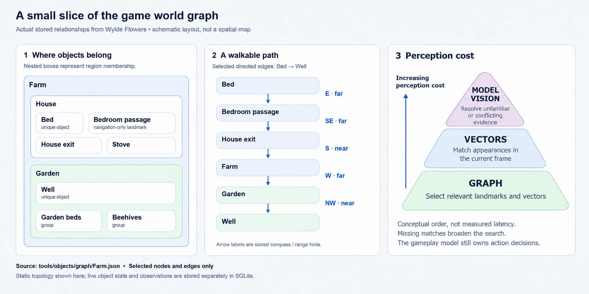

# An AI agent that plays Wylde Flowers

**Exploring how an AI agent can see, act, remember and learn in a real game.**

The agent works on tasks such as navigating between locations, tending garden beds, interacting with characters
and using shops. It observes screenshots, uses ordinary mouse and keyboard input, and checks game logs and saves
for additional evidence.

The goal is faster, more reliable play with less human intervention. The project improves the agent's ability to
play; it does not change the game.

   
  An earlier gameplay recording: visiting the bakery and talking to Angus (2× speed).
  <a href="docs/media/quest-1.mp4">Watch the full video</a>.

## The agent loop

**Observe → understand → decide → act → verify → learn**

The model owns the decisions. Visual recognition and memory supply evidence; each action produces a result to check
before continuing. When something unexpected happens, the agent revisits its understanding while retaining the task.

## Memory, navigation and perception

Three complementary layers help the agent interpret its surroundings:

- **Graph:** what exists, how places connect, and which landmarks to look for.
- **Visual embeddings:** recognise familiar objects and interaction prompts by their appearance.
- **Model vision:** how to interpret unfamiliar or conflicting evidence.

The pyramid shows a conceptual order of perception cost. The model still chooses actions throughout the loop.

The world graph gives navigation a destination and connected places to travel through. Current visual evidence
helps establish where the character is and which visible step makes progress. Recognising a landmark, moving toward
it and arriving are separate things to verify.

## Remembering the task

An interrupted task should retain its goal, current target and unfinished interaction. For gardening, that can mean
resuming planting or watering without repeating a completed harvest.

Long-lived knowledge and current observations serve different purposes. A remembered location is a clue; a fresh
view may show that it is wrong.

## Learning from surprises

A mistake can reveal different gaps:

- **Wrong state:** update what is believed about the world.
- **Unknown appearance:** add a confirmed visual example.
- **Unexpected result:** revise knowledge of how an interaction works.
- **Recurring system failure:** preserve the evidence for a reviewed implementation change.

Learning includes visual memories, world knowledge and agent-assisted development. It does not mean the agent
autonomously retrains a foundation model or rewrites itself during play.

## Making progress measurable

The project records observations, decisions, actions, outcomes and corrections. Evaluation asks:

- Did the task actually finish?
- How much time was spent observing, deciding and acting?
- How often did the agent get stuck or need human help?
- Did a correction solve the failure without breaking other behaviour?

A click being delivered is not proof of success. A moving character is not proof of useful progress.

## Stack and purpose

| Technology | Purpose |
|---|---|
| **Python** | Connect perception, memory, actions and verification in the gameplay loop. |
| **LLM/VLM agent** | Interpret the task and screenshots, choose actions and recover from surprises. The model is supplied by the host agent environment. |
| **DINOv2 + PyTorch** | Extract visual embeddings for recognising objects and landmarks. |
| **Apple Vision** | Read on-screen text and generate visual feature prints for prompts and icons. |
| **NumPy** | Compare visual embeddings against stored examples and process detection scores. |
| **NetworkX** | Represent and query relationships between places and objects. |
| **SQLite** | Persist tasks, observations, action history and world-state updates. |
| **Quartz + PyObjC** | Capture the game window and send mouse and keyboard input. |
| **Pillow** | Prepare screenshots and object crops for perception and review. |

## Status

This is an experimental project with live gameplay attempts, persistent memory, visual recognition, action
verification and evaluation tooling. Reliable unattended play and consistently fast decisions remain work in
progress. Proposed model combinations and performance targets are not presented as achieved results.

## Credits

*Wylde Flowers* © Studio Drydock. This is an unofficial project, not affiliated with or endorsed by Studio Drydock.

Imported game-reference material derives from the game's fan wiki (Fandom); CC BY-SA 3.0 attribution is retained.
